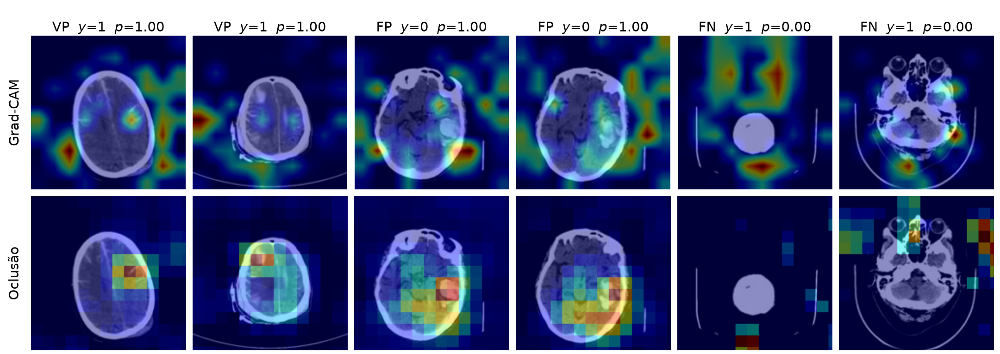
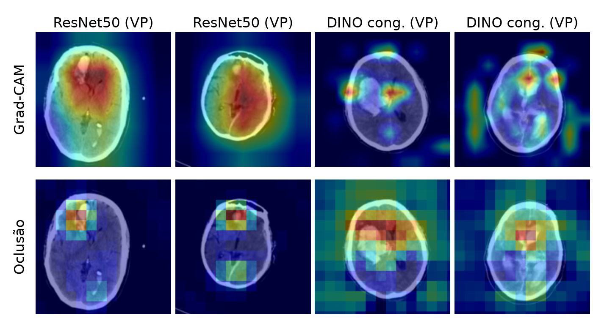

# TP2: Transferência de Aprendizado, Aumento de Dados e Explicabilidade

**Equipe G1 · RSNA 2019 Intracranial Hemorrhage Detection** (continuação do TP1)

Arisio Soares Andrade Filho · Júlio Sárney da Silva Silveira · Pablo Samuel Oliveira do Nascimento

Sistemas de Informação, Centro Universitário Católica de Quixadá (UniCatólica)

## Pergunta do trabalho
Modelos pré-treinados (CNN, ViT, DINO, DINOv2 e um modelo radiológico) superam o baseline clássico do TP1 (HOG + Random Forest)? Quais escolhas de pré-treino, ajuste fino e aumento de dados explicam o ganho, e as regiões usadas pelos modelos são plausíveis?

## Resultados principais
AUC-ROC de "qualquer hemorragia" no teste (112.993 imagens de 2.856 pacientes), média de 3 sementes. O IC de 95% vem de bootstrap em nível de paciente.

| Modelo | Congelado | Ajuste fino [IC 95%] |
|---|---|---|
| ViT-S/16 supervisionado | 0,886 | **0,964** [0,961; 0,967] |
| DINO ViT-S/16 | 0,908 | 0,963 [0,960; 0,967] |
| ResNet50 | 0,878 | 0,963 [0,959; 0,967] |
| DINOv2-S/14 | 0,893 | 0,961 [0,959; 0,965] |
| RadImageNet ResNet50 | 0,809 | 0,951 [0,947; 0,954] |
| ConvNeXt-T | 0,889 | não treinado |

Baselines do TP1 retreinados no treino completo: HOG + Random Forest 0,856 [0,848; 0,864] e classificador trivial 0,500.

- No ajuste fino, o ViT-S/16 empata com o ResNet50 e com o DINO nos testes pareados.
- Ablações com o ViT-S/16: taxa constante 0,960; descongelamento gradual 0,962; LLRD 0,952; sem aumento 0,960; TrivialAugment 0,963.

Tabelas completas em [`results/tables/`](results/tables) e resumo em [`figures/tabelas.md`](figures/tabelas.md).





## Protocolo
- **Dados:** todo o `stage_2_train` (752.803 imagens, 1 corrompida excluída). Cada DICOM é convertido para JPEG 192×192 com três janelas de HU nos canais: cérebro (40/80), subdural (80/200) e osso (600/2800).
- **Partição fixa por paciente** (70/15/15, semente 2026), com verificação de que nenhum paciente aparece em dois conjuntos. Treino: 527.215 imagens de 13.247 pacientes. Validação: 112.594 de 2.835. Teste: 112.993 de 2.856.
- Época, hiperparâmetros e limiar são escolhidos **somente na validação**.
- O teste é a partição retida por paciente. Não foi feita submissão no teste oficial da competição.
- Mesmo orçamento para todos os ajustes finos: 3 épocas de meia passada pelo treino, resolução 160 (154 no DINOv2), lote 128 e 3 sementes.
- Estatística: IC por bootstrap por paciente na semente de AUC mediana; comparações com bootstrap pareado e DeLong sobre a média das probabilidades das sementes.
- Os casos de explicabilidade foram fixados antes da geração dos mapas: [critério](docs/xai_selection_criterion.md) e [lista](configs/xai_cases.json).

## Estrutura
| Caminho | Função |
|---|---|
| `src/prep_dicom.py` | DICOM para JPEG de 3 janelas, metadados e lista de corrompidos |
| `src/build_dataset.py`, `src/split.py`, `src/labels.py` | rótulos e partição por paciente |
| `src/data.py` | leitura das imagens e políticas de aumento (`none`, `main`, `alt`) |
| `src/models.py` | backbones pré-treinados e descongelamento gradual |
| `src/train.py` | extrator congelado (`linear`) e ajuste fino (`const`, `cosine`, `llrd`, `gradual`) |
| `src/plan.py`, `src/run_phase.py` | lista e execução dos experimentos |
| `src/baselines.py` | baselines do TP1 no treino completo |
| `src/infer.py` | predições a partir dos pesos, sem retreinar |
| `src/stats.py`, `src/make_report.py` | métricas, intervalos, testes pareados e análise estratificada |
| `src/xai.py`, `src/run_xai.py` | Grad-CAM, oclusão, deleção e inserção, teste de sanidade |
| `src/figuras.py` | figura e tabelas resumidas |
| `notebooks/reproduzir_resultados.ipynb` | **reprodução das tabelas e figuras a partir dos pesos** |
| `results/`, `figures/` | tabelas e figuras geradas |
| `tests/` | testes com dados sintéticos |

## Instalação
```bash
pip install -r requirements.txt
python -m pytest tests
```

## Dados
Os dados são da [competição da RSNA no Kaggle](https://www.kaggle.com/competitions/rsna-intracranial-hemorrhage-detection) e não são redistribuídos aqui. A conversão e a partição são determinísticas.

```bash
# conversão em 3 partes (repetir com --shard 0, 1 e 2)
python -m src.prep_dicom --dicom_dir <stage_2_train> --out_dir ich192 --size 192 --workers 4 --shard 0 --nshards 3
# junta as partes e cria o splits.csv (partição por paciente)
python -m src.build_dataset --input_root <pasta_com_as_partes> --labels <stage_2_train.csv> --out_dir ich192
```
O arquivo excluído por estar corrompido é registrado em `corrupted_shard*.txt` durante a conversão.

## Treino
```bash
# A: extratores congelados
python -m src.run_phase --phase A --img_dir ich192 --splits ich192/splits.csv --out runs
# B: ajuste fino
python -m src.run_phase --phase B --img_dir ich192 --splits ich192/splits.csv --out runs
# C: ablação de ajuste fino, com o melhor modelo na validação
python -m src.run_phase --phase C --best_model vit_small_sup --img_dir ich192 --splits ich192/splits.csv --out runs
# D: ablação de aumento de dados
python -m src.run_phase --phase D --best_model vit_small_sup --img_dir ich192 --splits ich192/splits.csv --out runs
# baselines do TP1
python -m src.baselines --img_dir ich192 --splits ich192/splits.csv --out runs
```
Para o RadImageNet, o arquivo `ResNet50.pt` com os pesos do projeto [RadImageNet](https://github.com/BMEII-AI/RadImageNet) (cópia usada: `Lab-Rasool/RadImageNet`, no Hugging Face) deve ser salvo em `weights/radimagenet_resnet50.pt`.

## Reprodução sem retreinar
O notebook [`notebooks/reproduzir_resultados.ipynb`](notebooks/reproduzir_resultados.ipynb) executa estes passos a partir do pacote de pesos:

```bash
python -m src.infer --runs <pesos> --splits <splits.csv> --img_dir <ich192> --radimagenet_weights <ResNet50.pt> --out runs
python -m src.make_report --splits <splits.csv> --runs runs --out results/tables
python -m src.run_xai explain --cases configs/xai_cases.json --search <pesos> --img_dir <ich192> --out xai_out
python -m src.figuras --tables results/tables --xai_tables xai_out --xai_figs xai_out --out figures
```

## Pesos treinados
São 54 execuções, com os pesos do ajuste fino em meia precisão, as cabeças lineares dos extratores congelados e as predições dos baselines. O link do pacote será adicionado nesta seção.

## Hardware e custo
Treino no Kaggle com 2× Tesla T4. Por execução: ajuste fino de 22 a 35 min, extrator congelado de 3 a 6 min e HOG + Random Forest cerca de 7,5 h de CPU. Parâmetros e tempos por configuração estão em [`results/tables/main_table.csv`](results/tables/main_table.csv).
